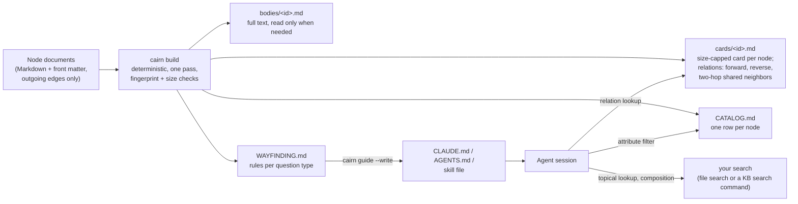

# Cairn

한국어 · [English](README.md)

서로 연결된 Markdown 지식 베이스를 에이전트가 더 적은 비용으로 검색하도록, 압축 카드와 길잡이 규칙을 만들어 주는 도구입니다.

Cairn은 서로 링크된 Markdown 노트 폴더를 읽고, 도구를 쓰는 LLM 에이전트(Claude Code, Codex 등)가 노트 대신 읽을 파일 묶음을 만드는 작은 생성기입니다. 만드는 파일은 다음과 같습니다.

- **압축 카드**: 노드마다 한 장씩, 정해진 크기 안에 그 노드를 고르는 데 필요한 내용만 담습니다. 끝의 관계 절에는 역방향 연결과 두 단계 이웃이 미리 적혀 있습니다.
- **속성 표**: 노드 하나가 한 행이라, 속성으로 거르는 질문은 파일 하나만 보고 답합니다.
- **길잡이 규칙**: 질문 종류마다 짧은 규칙 하나로, 에이전트가 어디부터 볼지 알려 줍니다.

같은 입력이면 늘 같은 결과가 나옵니다(LLM 요약도 임베딩도 쓰지 않습니다). 작은 지식 베이스는 1초도 안 걸려 만들어지고, Node.js 22 말고는 의존성이 없습니다.

저자·관리자: Chioh Song (워카 대표). 논문: *Cairn: Compact Cards and Wayfinding for Lower-Cost Agentic Search over Linked Knowledge Bases* (arXiv:XXXX.XXXXX, 번호는 나중에 추가).

## 목차

- [Cairn 소개](#cairn-소개)
- [논문 결과](#논문-결과)
- [빠른 시작](#빠른-시작)
- [코딩 에이전트로 설치하기](#코딩-에이전트로-설치하기)
- [명령](#명령)
- [설정 항목](#설정-항목)
- [볼트 갱신](#볼트-갱신)
- [내 지식 베이스에서 측정하기](#내-지식-베이스에서-측정하기)
- [한계](#한계)
- [인용](#인용)
- [라이선스](#라이선스)
- [감사의 말과 AI 도구 사용](#감사의-말과-ai-도구-사용)

## Cairn 소개

연결된 지식 베이스를 검색하는 에이전트는 모델에 요청을 보낼 때마다 고정된 앞부분과 그때까지 받은 도구 결과를 전부 다시 읽습니다. 그래서 비용은 요청 횟수와 읽은 양에 따라 늘어납니다. 관계를 묻는 질문이 특히 비싼데, 문서에는 자기가 가리키는 연결만 적혀 있기 때문입니다. 어떤 노드를 거꾸로 가리키는 노드나 같은 근거 문서를 쓰는 노드를 찾으려면 다른 문서를 하나씩 열어 봐야 합니다. Cairn은 이 탐색을 질문이 들어오기 전, 색인을 만들 때 미리 해 둡니다.



Cairn이 다루는 데이터는 문서로 이뤄진 그래프입니다. 노드마다 식별자, 본문, 속성(사람들이 거를 때 쓰는 범주형 필드), 그리고 종류가 붙은 나가는 연결(예: `depends_on`, `related`, `evidence`, `cites`)이 있습니다. 생성기는 이것을 읽어 다음 파일을 씁니다.

| 산출물 | 내용 | 주요 설정 |
|---|---|---|
| `cards/<id>.md` | 제목, 한 줄 설명, 속성, 저자가 쓴 짧은 필드, 절 제목, 그리고 맨 끝의 **Relations** 절. Relations 절에는 종류별 나가는 연결, 종류별 역방향 연결, 같은 중간 노드(예: 같은 근거 문서)를 공유하는 두 단계 이웃이 들어갑니다 | 카드 크기 목표(기본 5 KB) |
| `CATALOG.md` | 노드마다 한 행: id, 제목, 속성 열, 연결 열 | 표 크기 목표(기본 20 KB) |
| `bodies/<id>.md` | 노드별 전문. 카드로 부족할 때만 엽니다 | 켜기/끄기 |
| `WAYFINDING.md` | 마커 사이에 든 길잡이 블록. 에이전트 지침 파일에 그대로 넣습니다 | 규칙 템플릿 |
| `INDEX.md` | 입구 파일: 파일 목록, 개수, 속성 값 | |
| `.cairn-fingerprint.json` | 입력(원본 파일, 설정, 생성기 버전)의 지문 | |

이웃 펼치기는 논문 3.1절을 따릅니다. 많은 노드가 가리키는 중간 노드(`hubThreshold` 이상인 허브)는 건너뛰고, 이웃은 최대 `k`개까지만 적습니다. 목록을 줄였을 때는 반드시 마커로 밝히므로, `none`이 나오면 이웃이 정말 없다는 뜻입니다.

```
- Used by (reverse of Depends on): qs-cli (Command-line runner); qs-config (Configuration loader); qs-dedupe (Deduplication); qs-io-base (I/O adapter base); qs-logging (Structured logging); qs-metrics (Metrics exporter) (6 of 16 shown — capped at k=6)
- Shares design docs with (two hops via Design docs): none shown (0 of 11 shown — 1 hub skipped: design_docs targets used by ≥10 nodes)
- Related from (reverse of Related): none
```

길잡이 블록은 질문을 네 종류로 나누고, 종류마다 먼저 볼 곳을 정해 줍니다.

| 질문 종류 | 먼저 볼 곳 |
|---|---|
| 주제 조회(내용이 어떤 주제와 맞는 노드 찾기) | 검색(카드를 대상으로 한 파일 검색, 또는 지식 베이스의 검색 명령). 그다음 맞는 카드, 결과가 없을 때만 본문 |
| 속성 필터(속성 값으로 노드 고르기) | `CATALOG.md` (파일 하나) |
| 관계 조회(선수 노드, 관련 노드, 역방향, 같은 근거) | 그 노드 카드의 Relations 절 |
| 여러 노드 조합(여러 주제를 함께 다루는 노드 여럿) | 주제마다 검색 한 번, 그 결과를 `CATALOG.md` 열과 합쳐서 |

블록에는 일반 규칙도 들어 있습니다. 본문은 필요할 때만 열고, 다른 경로로 한 번 더 확인하고, 볼트 파일은 셸 명령 대신 파일 도구로 읽고, 식별자는 돌려받은 그대로 씁니다. 질문 종류는 에이전트가 스스로 판단하며, 따로 분류기를 두지 않습니다.

생성 결과까지 담은 예제는 [`examples/quillstone/`](examples/quillstone/)에 있습니다. 가상의 데이터 파이프라인 라이브러리를 다룬 합성 지식 베이스(모듈 27개, 설계 문서 8개, 내용은 모두 지어낸 것)와 그 설정, 생성된 볼트, 길잡이 블록을 넣은 `AGENTS.md`가 들어 있습니다.

## 논문 결과

아래 수치는 논문에서 가져왔고, 한 가지 조건에서만 잰 값입니다. 단서와 함께 읽어 주세요.

- **조건.** 교육 모듈을 담은 한국어 지식 베이스 하나(모듈 64개), 설계 과정에서도 쓴 고정 질문 30개(따로 떼어 둔 평가용 질문 없음), 질문과 구성마다 1회 실행, 모델과 하네스 하나(claude-sonnet-5-5와 Claude Code 2.1.296). 비교 기준은 파일럿 구성으로, 전체 노트를 담은 Obsidian 방식 볼트에 서버 검색을 더한 것입니다.
- **주요 결과(검색 성능이 상한에 닿은 상태).** 파일럿 기준과 비교해 Cairn은 평균 토큰을 **35.0%** (95% CI [−46.1%, −21.2%]), 정가 기준 비용을 **41.9%** ([−58.2%, −19.5%]) 줄였습니다. 검색 성능은 두 구성 모두 상한이었습니다(질문 30개 모두 Recall@5 = 1.00. 30개 중 30개를 맞혔어도 실제 실패율이 11.6%까지일 가능성은 배제할 수 없습니다). 카드 크기의 중앙값은 3.3 KB, 파일럿 노트는 44.7 KB였습니다.
- **요인 분리 실험(2×2).** 압축 카드만 넣어도 토큰이 유의하게 줄었습니다(일반 지침과 함께 −21.3%). 길잡이 규칙만으로는 줄지 않았습니다(−6.8%, 유의하지 않음). 둘을 함께 쓰면 −37.0%였습니다.
- **관계 질문.** 관계 질문에서 비용이 줄어든 것은 미리 펼쳐 둔 이웃 목록 덕분이라기보다, 큰 노트 대신 작은 카드를 읽었기 때문으로 보는 편이 맞습니다. 30개 질문 가운데 펼친 이웃이 필요한 질문은 1개뿐이어서, 이웃 펼치기의 효과는 검증하지 못했습니다.
- **리뷰 반영 뒤 재측정.** 같은 시기에 돌린 기준과 비교해 Cairn은 평균 토큰을 **17.7%** 덜 썼습니다(95% CI [−31.0%, −3.3%]). 그런데 프롬프트가 똑같은 기준 구성 자체가 두 측정 사이에 −13.6% 움직였습니다. 그래서 확인된 것은 방향뿐이고, 크기는 확인되지 않았습니다.
- **효과 크기는 측정마다 달랐습니다.** 세 번의 측정에서 17.7%부터 37.0%까지였습니다(CLI 측정 35.0%, 요인 분리 실험 37.0%, 재측정 17.7%).
- **다른 분야, 언어, 질문 세트는 측정하지 않았습니다.** 다른 지식 베이스에 맞춰 쓰는 방법(논문 3.5절)은 설계 제안일 뿐이며, 절감 효과가 그대로 옮겨 간다고 가정하면 안 됩니다. 내 지식 베이스에서 직접 재 보세요([아래](#내-지식-베이스에서-측정하기)).

## 빠른 시작

필요한 것: Node.js 22 이상. 따로 설치할 것은 없습니다. 생성기는 Node 내장 모듈만 씁니다.

```sh
git clone https://github.com/Woka-inc/cairn
cd cairn
node bin/cairn.mjs build --config examples/quillstone/cairn.config.json
node bin/cairn.mjs check --config examples/quillstone/cairn.config.json
npm test
```

내 지식 베이스에 쓸 때는 설정 파일을 둘 폴더(보통 지식 베이스 저장소의 루트)에서 실행합니다.

```sh
# 1. Draft a config by scanning the notes (prints JSON; the report goes to stderr), then review and edit it.
node path/to/cairn/bin/cairn.mjs init notes > cairn.config.json

# 2. Build the vault (cards, CATALOG, INDEX, bodies, WAYFINDING).
node path/to/cairn/bin/cairn.mjs build

# 3. Insert the wayfinding block into your agent instruction file.
node path/to/cairn/bin/cairn.mjs guide --write AGENTS.md    # or CLAUDE.md, or a skill file

# 4. Verify.
node path/to/cairn/bin/cairn.mjs check
```

`init`이 내놓는 초안은 추정입니다. 빌드하기 전에 실제 노트 몇 개를 열어, 제안된 필드를 하나하나 확인하세요.

## 코딩 에이전트로 설치하기

[`INSTALL_PROMPT.ko.md`](INSTALL_PROMPT.ko.md) ([English](INSTALL_PROMPT.md))는 코딩 에이전트에 붙여 넣는 프롬프트입니다. 이 프롬프트를 받은 에이전트는 다음 순서로 일합니다.

1. 지식 베이스 경로와, 그 밖에 꼭 필요한 것만 묻습니다.
2. 이 저장소를 받습니다(clone하거나, 이미 있는 로컬 사본을 씁니다).
3. 실제 파일을 열어 노드 파일, id 필드, 거를 만한 속성, 종류가 붙은 연결 필드를 찾고, 필드 이름을 지어내지 않고 `cairn.config.json`을 씁니다(필드 역할이 애매하면 묻습니다).
4. 생성기를 실행합니다.
5. 길잡이 블록을 `CLAUDE.md`, `AGENTS.md`, 스킬 파일 중 하나에 마커로 감싸 넣습니다.
6. `cairn check`를 실행합니다.
7. 파일이 바뀔 때 다시 빌드하는 방법(git hook 또는 watch 명령)을 고를 수 있게 제안하고, 한 일을 보고합니다.

## 명령

```
cairn build [--config cairn.config.json] [--if-stale] [--quiet]
cairn check [--config cairn.config.json]
cairn guide [--config cairn.config.json] [--write FILE]
cairn init  <kb-folder> [--config cairn.config.json] [--write] [--force]
cairn watch [--config cairn.config.json]
```

실행은 `node path/to/cairn/bin/cairn.mjs <command>` 형태로 합니다.

| 명령 | 설명 |
|---|---|
| `build` | 노트를 읽고, 그래프를 펼치고, 모든 파일을 렌더링하고, 크기 목표를 검사합니다. 결과는 옆에 만든 임시 폴더에 먼저 써서 검증하고, 그다음에야 제자리로 바꿔 넣습니다. 카드, 표, 색인 가운데 하나라도 목표를 넘으면 빌드가 실패하고 이전 볼트는 그대로 남습니다. `--if-stale`을 주면 지문이 그대로일 때 빌드를 건너뜁니다. |
| `check` | 읽기만 합니다. 설정이 올바른지, 지문이 현재 입력과 맞는지, 모든 파일이 새로 빌드한 결과와 바이트 단위로 같은지, 크기 목표를 지켰는지, 노드마다 카드 한 장과 표 한 행이 있는지 확인합니다. 문제가 하나라도 있으면 1로 끝납니다. |
| `guide` | 길잡이 블록을 출력합니다. `--write FILE`을 주면 블록을 `<!-- cairn:wayfinding:start -->`와 `<!-- cairn:wayfinding:end -->` 사이에 넣습니다(기존 블록이 있으면 바꾸고, 없으면 끝에 붙입니다). |
| `init` | 폴더를 훑어 설정 초안을 제안합니다. id·제목·설명 필드, 연결 필드(값이 노드 id로 풀리는 필드), 속성(값의 종류가 적은 필드), 카드 필드, 공유 중간 노드로 쓸 연결을 고릅니다. `--write`가 없으면 JSON을 출력합니다. |
| `watch` | `source.dir` 아래 파일이나 설정이 바뀌면 다시 빌드합니다. |

종료 코드: 0 정상, 1 실패, 2 사용법·설정 오류, 4 다른 빌드가 잠금을 잡고 있음.

## 설정 항목

설정 파일은 `cairn.config.json`입니다. 상대 경로는 설정 파일이 있는 폴더를 기준으로 풉니다. 모르는 키는 거부하고(비슷한 키를 제안합니다), 문제가 여럿이면 한 번에 모두 알려 줍니다.

```json
{
  "source": { "dir": "kb", "include": ["**/*.md"], "exclude": ["README.md"] },
  "idField": "id",
  "titleField": "title",
  "descriptionField": "summary",
  "attributes": ["layer", "stability", "language", "owner"],
  "edges": [
    { "field": "depends_on", "label": "Depends on", "reverse": "Used by" },
    { "field": "related", "label": "Related", "reverse": "Related from" },
    { "field": "design_docs", "label": "Design docs", "reverse": "Cited by" }
  ],
  "sharedNeighbors": { "via": "design_docs", "label": "Shares design docs with", "hubThreshold": 10 },
  "k": 6,
  "card": { "fields": ["goal"], "headings": true, "maxBytes": 5120 },
  "catalog": { "maxBytes": 20480 },
  "output": "cairn-vault"
}
```

| 키 | 기본값 | 뜻 |
|---|---|---|
| `source.dir` | 필수 | 지식 베이스 폴더. `output`과 겹치면 안 됩니다. |
| `source.include` | `["**/*.md"]` | 노드 파일을 고르는 glob(`*`, `**`, `?`). `source.dir` 기준입니다. 점으로 시작하는 폴더는 항상 건너뜁니다. |
| `source.exclude` | `[]` | 뺄 파일의 glob(README, 템플릿, 초안). |
| `idField` | `"id"` | 노드 id가 든 front matter 필드. `"$filename"`이면 확장자를 뺀 파일 이름을 씁니다. id가 없는 파일은 경고와 함께 건너뛰고, id가 겹치면 빌드가 실패합니다. |
| `titleField` | `"title"` | 노드 제목으로 쓸 필드(없으면 id를 씁니다). |
| `descriptionField` | 없음 | 카드 제목 아래에 붙일 한 줄 설명(선택). |
| `attributes` | `[]` | 사람들이 거를 때 쓰는 필드. 카드 front matter, `CATALOG.md`의 열, `INDEX.md`의 값별 개수가 됩니다. |
| `edges[]` | `[]` | 종류가 붙은 연결 필드. 문자열 하나만 쓰면 `{ "field": "<name>" }`의 줄임입니다. |
| `edges[].field` | 필수 | 대상 id를 담은 front matter 필드(목록 또는 단일 값). `[[id]]`, `[[id\|alias]]`, `[text](path/id.md)`, `path/id.md`는 모두 `id`로 맞춥니다. |
| `edges[].label` | 필드 이름에서 만듦 | 카드에 적을 이름. |
| `edges[].reverse` | 없음 | 역방향에 붙일 이름(예: `"Used by"`). 이 값을 넣으면 카드마다 이 연결로 자기를 가리키는 노드를 적습니다. 사람들이 "X에 의존하는 것은 무엇인가"를 묻는 연결에 넣으세요. |
| `edges[].external` | `false` | 대상이 노드가 아닌 연결(예: 데이터셋 이름). 대상은 글자로만 적고, 공유 중간 노드로는 쓸 수 있습니다. 이 값이 없으면 모르는 id로 가는 연결은 경고와 함께 버립니다. |
| `sharedNeighbors.via` | 없음 | 대상을 공유 중간 노드로 쓸 연결 필드(근거, 인용, 데이터셋, 설계 문서). 같은 중간 노드를 가리키는 두 노드가 두 단계 이웃입니다. 그런 질문이 실제로 나오는 곳에만 넣으세요. |
| `sharedNeighbors.label` | `"Shares <label> with"` | 카드에 적을 이름. |
| `sharedNeighbors.hubThreshold` | `9` | 이 수 이상의 노드가 쓰는 중간 노드는 허브로 보고 건너뜁니다(건너뛴 사실은 마커에 적습니다). |
| `k` | `10` | 역방향 목록과 두 단계 목록에 적는 이웃의 최대 수. 공유 이웃은 공유하는 중간 노드 수로, 같으면 id 순으로 정렬합니다. 나가는 연결은 전부 적습니다. |
| `card.fields` | `[]` | 카드에 둘, 저자가 쓴 짧은 필드. 이름 또는 `{ "field", "label" }`으로 적습니다. |
| `card.headings` / `card.headingLevels` / `card.maxHeadings` | `true` / `[2]` / `20` | 카드에 적을 본문의 절 제목. |
| `card.maxFieldChars` | `400` | 카드에 둔 필드를 이 글자 수에서 자릅니다(전문은 본문에 그대로 있습니다). |
| `card.maxBytes` | `5120` | 카드 크기 목표. 볼트를 바꾸기 전에 검사합니다. |
| `card.titlesInRelations` | `true` | 관계 목록에 `id` 대신 `id (Title)`을 씁니다. |
| `catalog.maxBytes` | `20480` | 속성 표 크기 목표. 표는 노드 수에 비례해 커지므로, 이 값이 표 하나로 다룰 수 있는 지식 베이스의 크기를 정합니다. |
| `catalog.edgeColumns` | external이 아닌 연결 전부 | 표의 열로 보일 연결 필드. |
| `index.maxBytes` | `4096` | `INDEX.md` 크기 목표. |
| `bodies` | `true` | `bodies/<id>.md`를 쓸지 정합니다. |
| `output` | `"cairn-vault"` | 출력 폴더. Cairn이 만들지 않은 폴더가 비어 있지 않으면 바꾸지 않습니다. |
| `wayfinding.vaultPath` | 설정 파일 기준의 `output` | 규칙에서 볼트를 가리킬 경로(지침 파일이 다른 곳에 있으면 지정합니다). |
| `wayfinding.search` | `cards/` 대상 파일 검색 | 주제 검색 지시문. 예: ``"run `kb search \"<query>\"`"``. |
| `wayfinding.rules.topical` / `.attribute` / `.relation` / `.composition` | 내장 | 규칙 템플릿. 자리표시자: `{vault}`, `{search}`, `{attributes}`, `{edges}`, `{expanded}`, `{source}`. |
| `wayfinding.general` | 일반 규칙 4개 | 일반 규칙을 이 값으로 바꿉니다. |
| `wayfinding.extraRules` | `[]` | 네 종류 규칙 뒤에 덧붙일 규칙 줄. |

출력은 결정적입니다. 자연 정렬로 순서를 고정하고, 타임스탬프를 넣지 않고, 줄바꿈은 `\n`만 씁니다. 입력이 같으면 어느 컴퓨터에서든 바이트 단위로 같은 파일이 나옵니다.

## 볼트 갱신

지문에는 원본 파일, 설정, 생성기 버전이 들어갑니다. 이 가운데 하나라도 바뀌면 다시 빌드합니다.

- **git hook**: [`hooks/post-merge.sample`](hooks/post-merge.sample)을 `.git/hooks/post-merge`(와 `post-checkout`)로 복사하고, 맨 위의 경로 두 개를 고친 뒤 실행 권한을 줍니다. 이 훅은 `build --if-stale --quiet`를 실행하며 git 작업을 막지 않습니다.
- **watch**: 편집하는 동안 `node path/to/cairn/bin/cairn.mjs watch`를 켜 둡니다.
- **CI**: 볼트를 커밋한다면, `cairn check`로 볼트가 낡은 pull request를 실패로 처리합니다.

볼트를 다룰 때는 원본 노트의 접근 규칙을 그대로 따릅니다. 노트가 비공개라면 볼트도 노트와 같은 곳에 두세요(예: `.gitignore`에 넣고, 동기화하거나 공개하는 폴더 밖에 둡니다). 지문은 자기를 계산한 사본만 보므로, 갱신이 늦은 로컬 사본은 아무 알림 없이 낡아 갑니다.

## 내 지식 베이스에서 측정하기

절감 폭은 지식 베이스, 질문 구성, 하네스에 따라 다릅니다. Cairn을 들이기 전에, 같은 고정 질문으로 지금 쓰는 구성과 비교해 보세요. 방법은 [`docs/measure.ko.md`](docs/measure.ko.md) ([English](docs/measure.md))에 있습니다. 줄이면 다음과 같습니다.

1. 질문 세트를 미리 정해 둡니다(네 가지 질문 종류를 모두 넣고, 가능하면 설계에 쓰지 않은 질문을 따로 둡니다).
2. 기준 구성(원본 노트만, 검색만, 또는 둘 다)과 Cairn을 같은 모델, 하네스, 도구, 턴 제한으로, 같은 기간에, 질문마다 여러 번 실행합니다.
3. 실행마다 토큰, 정가 기준 비용, API 요청 수를 JSONL로 기록합니다.
4. `node scripts/measure.mjs runs.jsonl --baseline baseline --treatment cairn --by type`을 실행하면 평균의 비와, 질문을 짝지어 구한 부트스트랩 신뢰구간이 나옵니다.

## 한계

- **근거는 지식 베이스 하나에서 나왔습니다.** 분야와 언어도 하나씩이고, 질문 30개는 설계에 쓴 질문과 겹치며, 질문마다 한 번씩만 실행했습니다. 효과 크기는 17.7%에서 37.0%까지 달랐습니다. 다른 조건은 측정하지 않았습니다.
- **펼친 이웃이 절감의 원인인지는 검증하지 않았습니다.** 관계 질문에서 잰 절감은 대부분 큰 노트 대신 작은 카드를 읽은 데서 나왔습니다.
- **길잡이 규칙만으로는** 요인 분리 실험에서 토큰이 유의하게 줄지 않았습니다. 압축 카드와 함께 쓸 때 효과가 있었습니다.
- **주제 질문은 검색만 쓰는 구성보다 비쌀 수 있습니다.** 첫 요청의 문맥이 더 크고, 그 문맥을 요청마다 다시 읽기 때문입니다. 논문 조건에서는 주제 조회가 전체 질문의 약 70%를 넘으면 토큰 수 기준으로, 약 95%를 넘으면 정가 기준 비용으로 Cairn이 검색만 쓰는 구성보다 비싸졌습니다. 내 질문 구성부터 파악하세요.
- **규모.** 속성 표는 노드 수에 비례해 커집니다(논문의 선형 외삽으로 노드 1,000개에서 약 232 KB). 큰 지식 베이스라면 표를 나누거나, 그 영향을 알고서 목표를 올리세요.
- **이 구현은 논문에서 쓴 사내 생성기를 일반화한 것이고, 측정한 코드 그 자체가 아닙니다.** 기본값은 논문의 설계(카드 목표 5 KB, 허브 제외, 상위 k개 제한, 명시적인 잘림 마커, 바꾸기 전 크기 검사)를 따르지만, 이 코드 그대로는 측정하지 않았습니다.
- front matter 파서는 지식 베이스 노트가 쓰는 범위의 YAML(매핑, 목록, 흐름 컬렉션, 따옴표 스칼라와 블록 스칼라)만 읽습니다. 앵커, 별칭, 태그는 줄 번호와 함께 거부합니다.

## 인용

```bibtex
@misc{song2026cairn,
  author        = {Chioh Song},
  title         = {Cairn: Compact Cards and Wayfinding for Lower-Cost Agentic Search over Linked Knowledge Bases},
  year          = {2026},
  eprint        = {XXXX.XXXXX},
  archivePrefix = {arXiv},
  note          = {arXiv:XXXX.XXXXX}
}
```

[`CITATION.cff`](CITATION.cff)도 함께 보세요.

## 라이선스

- 코드(`bin/`, `src/`, `scripts/`, `test/`, `hooks/`): [MIT](LICENSE).
- 문서, 예제 지식 베이스, 논문 본문: [CC BY 4.0](LICENSE-docs).

## 감사의 말과 AI 도구 사용

이 저장소를 포함해 Cairn의 설계, 구현, 측정, 분석, 글쓰기는 저자의 지시에 따라 Anthropic의 Claude가 수행했습니다. 내용의 책임은 저자에게 있습니다.
