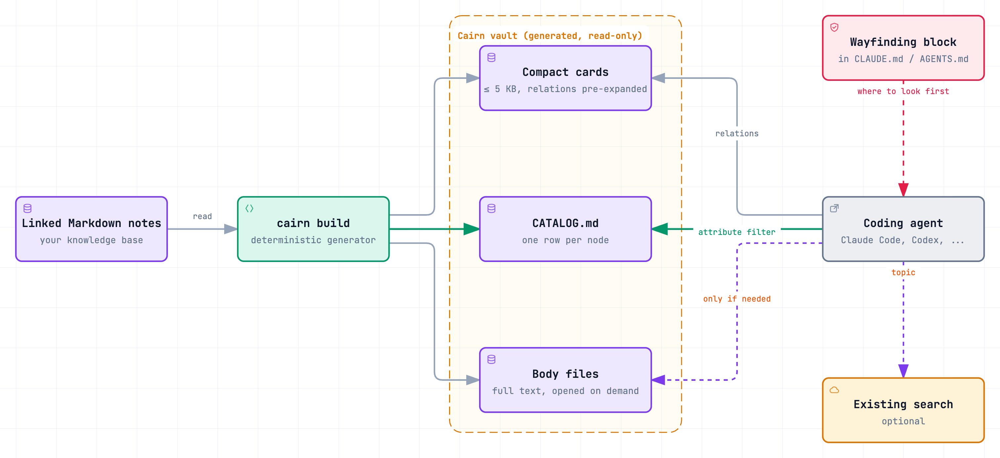
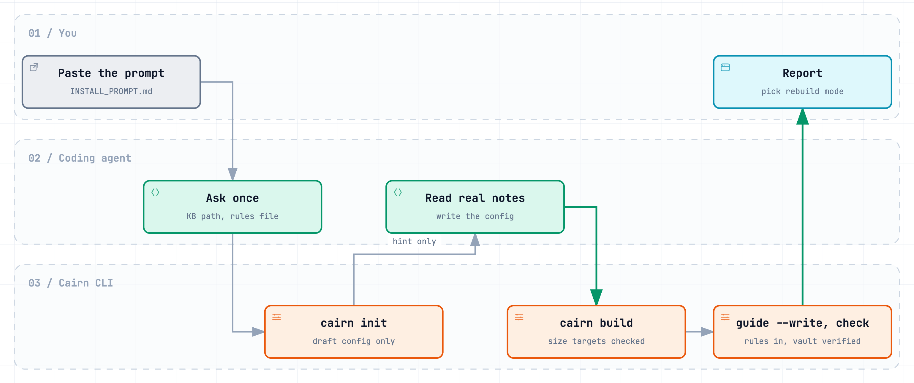
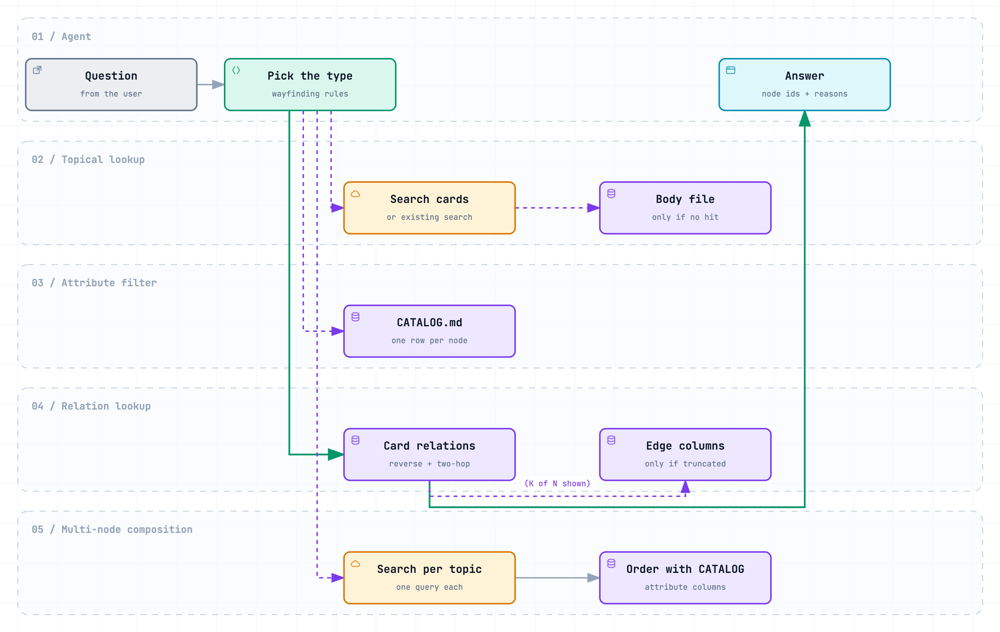

# Cairn

[](https://github.com/Woka-inc/cairn/actions/workflows/test.yml)


[](LICENSE)

[English](README.md) · 한국어

**링크로 엮인 Markdown 지식 베이스를 에이전트가 더 적은 비용으로 찾게 해 주는 경량 카드와 길 안내.**

<p align="center">
  <picture>
    <source media="(prefers-color-scheme: dark)" srcset="docs/assets/architecture-dark.png">
    
  </picture>
</p>

저자·관리자: Chioh Song (워카 CEO) · 논문: *Cairn: Compact Cards and Wayfinding for Lower-Cost Agentic Search over Linked Knowledge Bases* (arXiv 번호는 나중에 추가)

## 목차

- [Cairn은 무엇인가](#cairn은-무엇인가)
- [이 저장소에 든 것](#이-저장소에-든-것)
- [결과](#결과)
- [빠른 시작: 프롬프트 하나로 설치](#빠른-시작-프롬프트-하나로-설치)
- [에이전트는 Cairn을 이렇게 쓴다](#에이전트는-cairn을-이렇게-쓴다)
- [내 지식 베이스에서 재 보기](#내-지식-베이스에서-재-보기)
- [자주 묻는 질문](#자주-묻는-질문)
- [한계](#한계)
- [인용](#인용)
- [라이선스와 감사의 말](#라이선스와-감사의-말)

## Cairn은 무엇인가

Claude Code나 Codex 같은 코딩 에이전트가 링크된 노트 폴더를 뒤질 때는 모델 요청마다 비용이 듭니다. 요청할 때마다 시스템 안내와 앞서 받은 도구 결과를 전부 다시 읽기 때문입니다. 그래서 비용은 **요청을 몇 번 하느냐**와 **얼마나 많이 읽느냐**에 따라 커집니다. 비용을 키우는 원인은 두 가지입니다.

1. **노트 하나가 큽니다.** 고르는 데 필요한 사실 세 가지를 알려고 40 KB짜리 노트를 엽니다.
2. **링크가 한 방향입니다.** 노트에는 자기가 기대는 노트만 적혀 있고, 자기를 기대는 노트는 적혀 있지 않습니다. "X를 쓰는 건 뭐지?", "같은 자료를 인용하는 건 또 뭐가 있지?" 같은 질문을 받으면 에이전트는 노트를 하나씩 차례로 열어 봐야 합니다.

Cairn은 이 일을 질문할 때가 아니라 색인할 때 미리 해 둡니다. 노트를 한 번 훑어서, 에이전트가 노트 대신 읽을 세 가지를 만듭니다.

| 구성 | 무엇인가 | 답하는 질문 |
|---|---|---|
| **경량 카드** | 노트마다 한 장(목표 5 KB). 고르는 데 필요한 내용만 담고, 끝의 관계 절에 역방향 연결과 두 다리 건넌 이웃을 미리 적어 둡니다 | "X는 무엇에 기대고, 무엇이 X에 기대나?" |
| **속성 표** | `CATALOG.md`. 노트 하나가 한 행이고 속성과 연결이 열로 들어갑니다 | "안정판이고, A팀 담당이고, Python인 노트는?" |
| **길 안내 규칙** | 질문 종류마다 짧은 규칙 하나. `CLAUDE.md`나 `AGENTS.md`에 넣습니다 | "어디부터 볼까?" |

본문은 본문 파일로 따로 남겨 두고, 카드만으로 부족할 때만 엽니다. 만들 때 LLM도 임베딩도 쓰지 않고 Node.js 22 말고는 의존성이 없습니다. 같은 노트에서는 언제나 바이트까지 같은 결과가 나옵니다.

## 이 저장소에 든 것

| 경로 | 무엇인가 |
|---|---|
| [`bin/cairn.mjs`](bin/cairn.mjs), [`src/`](src/) | 생성기와 명령: `init`, `build`, `guide`, `check`, `watch` |
| [`INSTALL_PROMPT.ko.md`](INSTALL_PROMPT.ko.md) | 코딩 에이전트에 붙여 넣는 프롬프트. 내 지식 베이스에 Cairn을 세팅해 줍니다 |
| [`examples/quillstone/`](examples/quillstone/) | 가상의 데이터 파이프라인 라이브러리를 다룬 노트 35개, 그 설정, 만들어진 볼트, 길 안내 블록을 넣은 `AGENTS.md` |
| [`docs/configuration.ko.md`](docs/configuration.ko.md) | 명령, 설정 항목 전부, 설정과 볼트를 둘 곳, 볼트를 최신으로 유지하는 법 |
| [`docs/measure.ko.md`](docs/measure.ko.md), [`scripts/measure.mjs`](scripts/measure.mjs) | 지금 쓰는 구성과 Cairn을 비교하는 방법, 짝지은 부트스트랩 분석 스크립트 |
| [`hooks/post-merge.sample`](hooks/post-merge.sample) | 노트가 바뀌면 볼트를 다시 만드는 git 훅 |
| [`test/`](test/) | `node --test` 시험(결정론, 크기 상한, 역방향·두 다리 연결, 잘림 표시, 설정 오류) |

## 결과

논문은 운영 중인 지식 베이스 하나에서 쟀습니다. 한국어 교육 모듈 64개, 질문 종류 네 가지에 걸친 고정 질문 30개, 질문마다 1회 실행, Claude Code와 claude-sonnet-5-5입니다. 네 구성 모두 같은 모델·하네스·질문을 썼습니다.

| 구성 | Recall@5 | MRR | API 요청 수 | 평균 토큰 | 평균 정가 환산 비용 |
|---|---|---|---|---|---|
| 볼트만 (노트 전체) | 1.00 | 1.00 | 3.43 | 37,664 | $0.0526 |
| 서버 검색만 | 0.90 | 0.95 | 3.30 | 30,364 | $0.0421 |
| 볼트 + 서버 검색 (시범 구성) | 1.00 | 1.00 | 3.03 | 33,245 | $0.0427 |
| **Cairn** | **1.00** | **1.00** | **2.40** | **21,597** | **$0.0248** |

- 시범 구성과 비교해 Cairn은 평균 토큰을 **35.0%**(95% 구간 [−46.1%, −21.2%]), 비용을 **41.9%** 줄였습니다. 정답 찾기는 두 구성 모두 만점이었습니다. 카드 크기의 중앙값은 3.3 KB, 시범 구성의 노트는 44.7 KB였습니다.
- 2×2 분리 측정에서는 경량 카드만 바꿔도 토큰이 21.3% 줄었습니다. 길 안내만 붙이면 유의하게 줄지 않았고(−6.8%), 둘을 함께 쓰면 37.0% 줄었습니다.
- 나중에 같은 날의 기준선과 다시 재 보니 감소 폭은 **17.7%**(95% 구간 [−31.0%, −3.3%])였습니다. 기준선 자체도 두 측정 사이에 13.6% 움직였습니다. 그래서 줄어드는 **방향**은 확인됐지만 **크기**는 확인되지 않았습니다.

이 숫자는 한 분야, 한 언어, 설계에도 쓴 질문으로 잰 사례 하나입니다. 기대기 전에 [내 지식 베이스에서 재 보세요](#내-지식-베이스에서-재-보기).

## 빠른 시작: 프롬프트 하나로 설치

<p align="center">
  <picture>
    <source media="(prefers-color-scheme: dark)" srcset="docs/assets/install-dark.png">
    
  </picture>
</p>

노트가 있는 프로젝트에서 코딩 에이전트를 열고 [`INSTALL_PROMPT.ko.md`](INSTALL_PROMPT.ko.md)의 내용을 붙여 넣으세요. 에이전트가 지식 베이스 경로를 한 번 묻고, 필드 이름을 쓰기 전에 실제 노트를 열어 확인합니다. 그다음 볼트를 만들고, 지침 파일의 표시 사이에 규칙을 넣고, `cairn check`로 검사합니다. 노트는 고치지 않고, 요청하지 않으면 커밋도 하지 않습니다.

손으로 하고 싶다면 Node.js 22 이상만 있으면 됩니다.

```sh
git clone https://github.com/Woka-inc/cairn
node cairn/bin/cairn.mjs init notes --config cairn.config.json --write   # 설정 초안. 직접 확인하세요
node cairn/bin/cairn.mjs build                                           # 볼트 만들기
node cairn/bin/cairn.mjs guide --write AGENTS.md                          # 또는 CLAUDE.md
node cairn/bin/cairn.mjs check                                           # 검사
```

`init`은 초안입니다. 만들기 전에 실제 노트 몇 개를 열어 필드마다 맞는지 확인하세요. 설정 항목은 [`docs/configuration.ko.md`](docs/configuration.ko.md)에 모두 있습니다.

내 노트 없이 먼저 써 보려면:

```sh
git clone https://github.com/Woka-inc/cairn && cd cairn
npm run build-example && npm run check-example && npm test
```

## 에이전트는 Cairn을 이렇게 쓴다

<p align="center">
  <picture>
    <source media="(prefers-color-scheme: dark)" srcset="docs/assets/wayfinding-dark.png">
    
  </picture>
</p>

규칙은 지침 파일에 든 평범한 글이라, `CLAUDE.md`나 `AGENTS.md`를 읽는 에이전트라면 누구나 따를 수 있습니다. 분류기나 서버는 없습니다. 카드가 가장 힘을 쓰는 곳은 관계 질문입니다. 예시의 카드 한 장에는 그 노트를 가리키는 노트와 같은 설계 문서를 공유하는 노트가 적혀 있고, 목록이 잘리면 잘렸다고 분명히 적힙니다.

```
- Used by (reverse of Depends on): qs-cli (Command-line runner); qs-config (Configuration loader); qs-dedupe (Deduplication); qs-io-base (I/O adapter base); qs-logging (Structured logging); qs-metrics (Metrics exporter) (6 of 16 shown — capped at k=6)
- Related from (reverse of Related): none
- Shares design docs with (two hops via Design docs): qs-dedupe (Deduplication) ×1; qs-tx-filter (Filtering) ×1; qs-tx-join (Joins) ×1; qs-tx-map (Row mapping) ×1; qs-tx-window (Windowed aggregation) ×1 (5 of 14 shown — 1 hub skipped: design_docs targets used by ≥7 nodes)
```

그래서 `none`은 그런 이웃이 정말 없다는 뜻이고, 에이전트는 더 찾지 않고 멈춥니다. 예시에서 만든 규칙은 [`examples/quillstone/AGENTS.md`](examples/quillstone/AGENTS.md)에 있습니다.

## 내 지식 베이스에서 재 보기

얼마나 줄어드는지는 노트, 질문 구성, 하네스에 따라 다릅니다. 공정하게 비교하는 방법은 [`docs/measure.ko.md`](docs/measure.ko.md)에 있습니다.

1. 질문 네 종류를 모두 담은 질문 세트를 미리 고정하세요. 가능하면 일부는 조정에 쓰지 말고 따로 떼어 두세요.
2. 지금 쓰는 구성과 Cairn을 같은 모델·도구·턴 제한으로, 같은 시기에, 질문마다 여러 번 돌리세요.
3. 실행마다 토큰, 비용, 요청 수를 JSONL로 남기세요.
4. `node scripts/measure.mjs runs.jsonl --baseline baseline --treatment cairn --by type`으로 변화율과 짝지은 부트스트랩 신뢰구간을 내세요.

## 자주 묻는 질문

**RAG나 벡터 DB를 대신하나요?** 아닙니다. 파일·검색 도구로 링크된 문서를 훑는 에이전트를 위한 것입니다. 이미 검색 명령이 있다면, Cairn의 규칙이 주제 질문은 그 검색으로 보내고 관계와 속성 조건에는 카드와 표를 쓰게 합니다.

**노트를 바꾸나요?** 아닙니다. 노트는 읽기만 하고 볼트는 따로 만듭니다. 기존 파일 가운데 고치는 것은 지침 파일 하나이고, 그것도 `cairn:wayfinding` 표시 사이만 고칩니다.

**노트에 무엇이 있어야 하나요?** YAML front matter가 있는 Markdown 파일이면 됩니다. id(또는 파일 이름)가 있어야 하고, 제목, 거를 때 쓰는 속성 몇 개, 다른 노트를 가리키는 필드(`depends_on`, `related`, `cites` 등)가 있으면 좋습니다. 옵시디언 볼트, 위키, 문서 폴더 모두 됩니다.

**얼마나 큰 지식 베이스까지 되나요?** 논문 사례는 노트 64개, 예시는 35개입니다. 속성 표는 노트 수에 비례해 커지고 논문의 외삽으로는 노트 1,000개에서 약 232 KB가 되므로, 아주 큰 묶음은 표를 나누거나 그 영향을 알고 목표를 올려야 합니다.

**볼트를 커밋해도 되나요?** 노트와 같은 내용이 들어 있으니 공개 범위도 노트와 같게 다뤄야 합니다. git에서 빼 두는 것이 안전한 기본값입니다. [`docs/configuration.ko.md`](docs/configuration.ko.md#볼트-갱신)를 보세요.

**어떤 에이전트에서 되나요?** 지침 파일을 읽고 파일 읽기·검색 도구가 있는 에이전트라면 됩니다. 논문은 Claude Code로 쟀습니다.

## 한계

- **잰 조건이 하나뿐입니다.** 한국어 지식 베이스 하나, 설계에도 쓴 질문 30개, 질문마다 1회 실행입니다. 세 번의 측정에서 효과 크기는 17.7%에서 37.0%까지 달랐습니다. 다른 분야·언어·질문 세트는 재지 않았습니다.
- **미리 펼친 이웃이 절감의 원인인지는 검증하지 않았습니다.** 관계 질문의 절감은 대부분 큰 노트 대신 작은 카드를 읽은 데서 나왔고, 30개 질문 가운데 두 다리 이웃이 필요한 질문은 하나뿐이었습니다.
- **길 안내만으로는 유의하게 줄지 않았습니다.** 경량 카드와 함께 쓸 때 효과가 있었습니다.
- **주제 질문이 대부분이면 검색만 쓰는 구성보다 비쌀 수 있습니다.** 논문 조건에서는 주제 찾기가 전체 질문의 약 70%(토큰 기준), 약 95%(정가 환산 비용 기준)를 넘으면 Cairn의 이점이 사라졌습니다.
- **이 코드는 논문에서 쓴 사내 생성기를 일반화한 것입니다.** 기본값은 잰 설계(5 KB 카드, 허브 제외, 상위 k개 목록, 명시적인 잘림 표시, 바꾸기 전 크기 검사)를 따르지만, 이 코드 그대로는 재지 않았습니다.
- **front matter**는 노트가 쓰는 범위의 YAML(매핑, 목록, 흐름 컬렉션, 따옴표·블록 스칼라)만 읽습니다. 앵커, 별칭, 태그는 줄 번호와 함께 거부합니다.

## 인용

```bibtex
@misc{song2026cairn,
  author        = {Chioh Song},
  title         = {Cairn: Compact Cards and Wayfinding for Lower-Cost Agentic Search over Linked Knowledge Bases},
  year          = {2026},
  eprint        = {XXXX.XXXXX},
  archivePrefix = {arXiv}
}
```

[`CITATION.cff`](CITATION.cff)도 함께 보세요.

## 라이선스와 감사의 말

- 코드(`bin/`, `src/`, `scripts/`, `test/`, `hooks/`): [MIT](LICENSE).
- 문서, 도식, 예시 지식 베이스, 논문 본문: [CC BY 4.0](LICENSE-docs).
- 도식은 [`docs/diagrams/`](docs/diagrams/)의 원본에서 [Archify](https://github.com/tt-a1i/archify)로 만들었습니다.

이 저장소를 포함해 Cairn의 설계, 구현, 측정, 분석, 글쓰기는 저자의 지시에 따라 Anthropic의 Claude가 수행했습니다. 내용의 책임은 저자에게 있습니다. 질문과 버그 제보는 [GitHub issues](https://github.com/Woka-inc/cairn/issues)로 해 주세요.
