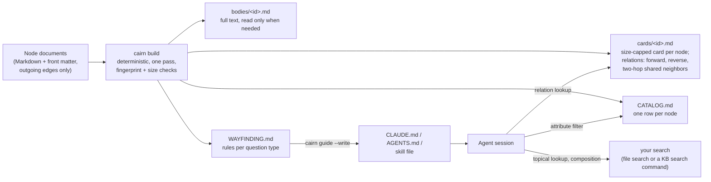

# Cairn

[한국어](README.ko.md) · English

Compact cards and wayfinding for lower-cost agentic search over linked Markdown knowledge bases.

Cairn is a small generator that reads a folder of linked Markdown notes and writes a layer that a tool-using LLM agent (Claude Code, Codex, and similar) can read instead of the notes themselves:

- **compact cards**: one size-capped card per node with only what is needed to choose the node, plus a relations section that already lists reverse edges and two-hop neighbors;
- **an attribute table**: one row per node, so attribute filters are answered from one file;
- **wayfinding rules**: one short rule per question type that tells the agent where to look first.

Generation is deterministic (no LLM summaries, no embeddings), takes well under a second for small knowledge bases, and has no dependencies beyond Node.js 22.

Author and maintainer: Chioh Song (Woka CEO). Paper: *Cairn: Compact Cards and Wayfinding for Lower-Cost Agentic Search over Linked Knowledge Bases* (arXiv:XXXX.XXXXX, identifier to be added).

## Contents

- [What Cairn is](#what-cairn-is)
- [Results from the paper](#results-from-the-paper)
- [Quick start](#quick-start)
- [Install with a coding agent](#install-with-a-coding-agent)
- [Commands](#commands)
- [Configuration reference](#configuration-reference)
- [Keeping the vault fresh](#keeping-the-vault-fresh)
- [Measure on your own knowledge base](#measure-on-your-own-knowledge-base)
- [Limitations](#limitations)
- [Citation](#citation)
- [License](#license)
- [Acknowledgments and use of AI tools](#acknowledgments-and-use-of-ai-tools)

## What Cairn is

An agent that searches a linked knowledge base re-reads a fixed prefix and every earlier tool result on each model request, so its cost grows with the number of requests and with how much it reads. Relation questions are expensive because a document stores only its outgoing edges: finding what points back to a node, or what shares an evidence document with it, means opening other documents one after another. Cairn moves that exploration from query time to indexing time.



The model is a graph of documents. Each node has an identifier, a body, attributes (categorical fields that people filter on), and typed outgoing edges (for example `depends_on`, `related`, `evidence`, `cites`). From that, the generator writes:

| Artifact | What it holds | Main parameter |
|---|---|---|
| `cards/<id>.md` | Title, one-line description, attributes, short author-written fields, section headings, and a **Relations** section at the end: outgoing edges by type, reverse edges by type, and two-hop neighbors that share an intermediate node (for example the same evidence document) | Card size target (default 5 KB) |
| `CATALOG.md` | One row per node: id, title, attribute columns, edge columns | Table size target (default 20 KB) |
| `bodies/<id>.md` | Full text of each node, opened only when a card is not enough | on/off |
| `WAYFINDING.md` | The wayfinding block, between markers, ready to insert into an agent instruction file | Rule templates |
| `INDEX.md` | Entry point: files, counts, attribute values | |
| `.cairn-fingerprint.json` | Fingerprint of the inputs (source files, config, generator version) | |

Neighborhood expansion follows Section 3.1 of the paper. Intermediates referenced by many nodes (hubs, at or above `hubThreshold`) are skipped, at most `k` neighbors are listed, and a shortened list always says so with an explicit marker, so that `none` only ever means that no neighbor exists:

```
- Used by (reverse of Depends on): qs-cli (Command-line runner); qs-config (Configuration loader); qs-dedupe (Deduplication); qs-io-base (I/O adapter base); qs-logging (Structured logging); qs-metrics (Metrics exporter) (6 of 16 shown — capped at k=6)
- Related from (reverse of Related): none
- Shares design docs with (two hops via Design docs): qs-dedupe (Deduplication) ×1; qs-tx-filter (Filtering) ×1; qs-tx-join (Joins) ×1; qs-tx-map (Row mapping) ×1; qs-tx-window (Windowed aggregation) ×1 (5 of 14 shown — 1 hub skipped: design_docs targets used by ≥7 nodes)
```

When `kindField` is set, a card also leaves out relation rows that no node of its kind has (a design document gets no "Depends on" row when no design document has that field), so the rows that remain are the ones where "none" carries information.

The wayfinding block distinguishes four question types and sends each to a first source:

| Question type | Look first at |
|---|---|
| Topical lookup (content matches a topic) | Search (file search over cards, or your KB's search command); then the matching cards; bodies only if there are no hits |
| Attribute filter (select by attribute values) | `CATALOG.md` (one file) |
| Relation lookup (prerequisite, related, reverse, shared evidence) | The Relations section of the node's card |
| Multi-node composition (several nodes covering several topics) | One search per topic, combined with the `CATALOG.md` columns |

General rules follow: open full bodies only when needed, verify through a second route, read vault files with file tools rather than shell commands, and use identifiers exactly as returned. The agent decides the question type itself; there is no classifier.

A worked example with generated output is in [`examples/quillstone/`](examples/quillstone/): a synthetic knowledge base for a fictional data-pipeline library (27 modules, 8 design documents; all content invented), its config, the generated vault, and an `AGENTS.md` with the inserted block. The example departs from the defaults on purpose (card 3 KB, table 8 KB, `k` 6): `k` is 6 so that the truncation marker appears on real cards (with only 35 short notes, `k` = 10 would rarely cut a list), and the targets are smaller because these notes are short, so a tighter target still leaves room and checks more strictly. The `$comment` at the top of its config says the same. Start from the defaults for your own knowledge base.

## Results from the paper

These numbers come from the paper and describe one setting only. Read the caveats with them.

- **Setting.** One Korean-language knowledge base of education modules (64 modules), 30 fixed questions that were also used during design (no held-out set), one run per question and configuration, one model and harness (claude-sonnet-5-5 with Claude Code 2.1.296). The baseline is the pilot: an Obsidian-style vault of full notes plus server search.
- **Main result (at the retrieval ceiling).** Relative to the pilot baseline, Cairn reduced mean tokens by **35.0%** (95% CI [−46.1%, −21.2%]) and list-price cost by **41.9%** ([−58.2%, −19.5%]). Retrieval was at the ceiling for both (Recall@5 = 1.00 on all 30 questions; with 30 of 30, true failure rates up to 11.6% cannot be ruled out). The median card was 3.3 KB against 44.7 KB for a pilot note.
- **Ablation (2×2).** Compact cards alone reduced tokens significantly (−21.3% with the generic guide); wayfinding alone did not (−6.8%, not significant). Both together gave −37.0%.
- **Relation questions.** The savings there are better explained by reading a small card instead of a large note than by the pre-expanded neighborhoods; only 1 of the 30 questions needed an expanded neighborhood, so the effect of expansion is untested.
- **Re-measurement after review fixes.** Against a concurrent baseline, Cairn used **17.7%** fewer mean tokens (95% CI [−31.0%, −3.3%]). The baseline itself, with identical prompts, moved by −13.6% between the two measurements, so only the direction is established, not the magnitude.
- **Effect size varied** between 17.7% and 37.0% across the three measurements (35.0% CLI, 37.0% ablation, 17.7% re-measurement).
- **Other domains, languages, and question sets were not measured.** The mapping to other knowledge bases (Section 3.5 of the paper) is a design proposal, and the savings should not be assumed to carry over. Measure on your own knowledge base ([below](#measure-on-your-own-knowledge-base)).

## Quick start

Requirements: Node.js 22 or later. There is nothing to install; the generator uses Node built-ins only.

```sh
git clone https://github.com/Woka-inc/cairn
cd cairn
node bin/cairn.mjs build --config examples/quillstone/cairn.config.json
node bin/cairn.mjs check --config examples/quillstone/cairn.config.json
npm test
```

For your own knowledge base, run from the folder where the config should live (see [where the config and the vault go](#where-the-config-and-the-vault-go)):

```sh
# 1. Draft a config by scanning the notes. Without --write it prints the JSON (report on stderr);
#    with --write it saves it as the --config file. Review and edit it.
node path/to/cairn/bin/cairn.mjs init notes --config cairn.config.json
node path/to/cairn/bin/cairn.mjs init notes --config cairn.config.json --write

# 2. Build the vault (cards, CATALOG, INDEX, bodies, WAYFINDING). Prints counts and actual sizes.
node path/to/cairn/bin/cairn.mjs build

# 3. Insert the wayfinding block into your agent instruction file.
node path/to/cairn/bin/cairn.mjs guide --write AGENTS.md    # or CLAUDE.md, or a skill file

# 4. Verify.
node path/to/cairn/bin/cairn.mjs check
```

`init` is best effort. Open a few real notes and confirm every field it proposes before you build. For `init`, `--config` names the config file the draft is for: `source.dir` is written relative to that file's folder.

Every config change, whatever the key, changes the vault (the wayfinding block is part of it). Run `build` again after any edit to the config, then `guide --write` and `check`. `guide` warns when the vault is stale, and `check` says why.

### Where the config and the vault go

All paths in the config are relative to its folder. `source.dir` is the folder that holds the notes; `output` is the vault folder (default `cairn-vault`, next to the config).

- **Notes in a subfolder** (for example `notes/` in a project): put the config at the project root with `"source": { "dir": "notes" }`. The vault goes next to the notes.
- **Notes are the whole repository**: either put the config one level up, next to the repository, so the vault sits outside it; or keep the config at the root with `"source": { "dir": "." }`, so the vault is a subfolder of the notes. Cairn leaves its own output out of the inputs, but other tools that read the notes (Obsidian, for example) will see it, so exclude it there and decide about `.gitignore` ([below](#keeping-the-vault-fresh)).
- `output` must not be the notes folder itself or contain it, because a build replaces the whole output folder; the error message suggests the fixes above.
- Set `wayfinding.instructionFile` to the agent instruction file (relative to the config). Paths in the block are written relative to that file, it is never read as a note even inside the notes folder, and `check` verifies that it carries the current block.

## Install with a coding agent

[`INSTALL_PROMPT.md`](INSTALL_PROMPT.md) ([한국어](INSTALL_PROMPT.ko.md)) is a prompt to paste into a coding agent. It makes the agent:

1. ask you for the knowledge-base path and anything else it truly needs;
2. get this repository (clone it, or use a local copy that is already there);
3. inspect real files to find the node files, the id field, attributes worth filtering on, and typed edge fields, then write `cairn.config.json` without inventing field names (it asks when a field's role is ambiguous);
4. run the generator;
5. insert the wayfinding block into `CLAUDE.md`, `AGENTS.md`, or a skill file between markers;
6. run `cairn check`;
7. offer an optional rebuild on change (git hook or watch command) and report what it did.

## Commands

```
cairn build [--config cairn.config.json] [--if-stale] [--quiet]
cairn check [--config cairn.config.json]
cairn guide [--config cairn.config.json] [--write FILE]
cairn init  <kb-folder> [--config cairn.config.json] [--write] [--force]
cairn watch [--config cairn.config.json]
```

Run them as `node path/to/cairn/bin/cairn.mjs <command>`.

| Command | What it does |
|---|---|
| `build` | Reads the notes, expands the graph, renders all files, checks size targets, writes to a temporary sibling folder, verifies it, and only then swaps it into place. Prints the counts and the actual sizes (largest card, `CATALOG.md`, `INDEX.md`) against their targets. If any card, the table, or the index exceeds its target, the build fails, lists each file with the bytes over, and leaves the previous vault untouched. `--if-stale` skips the build when the fingerprint is unchanged. |
| `check` | Read-only. Confirms the config is valid, the fingerprint matches the current inputs, every file equals a fresh build byte for byte, size targets are met (with the actual sizes), there is one card and one table row per node, and, when `wayfinding.instructionFile` is set, that file carries the current block. Exits 1 on any problem. |
| `guide` | Prints the wayfinding block, or with `--write FILE` inserts it between `<!-- cairn:wayfinding:start -->` and `<!-- cairn:wayfinding:end -->` (replacing an existing block, or appending one). Paths in the block are relative to `FILE`. It warns when the vault is stale and refuses to write into a note (a file inside `source.dir` with an id). |
| `init` | Scans a folder and proposes a config: id, title, and description fields, `source.exclude` (agent instruction files, READMEs, and files without the id field), a kind field, edge fields (values that resolve to node ids), attributes (low-cardinality fields), card fields, and a shared-intermediate edge. Fields that are complete within one kind (for example `status` on every design document) are proposed even when their overall share is low, and the report shows the per-kind coverage. `--config` names the config file the proposal is for (`source.dir` is relative to its folder). Prints JSON unless `--write`. |
| `watch` | Rebuilds when files under `source.dir` or the config change. |

Exit codes: 0 ok, 1 failure, 2 usage or config error, 4 another build holds the lock.

## Configuration reference

`cairn.config.json`. Relative paths are resolved against the folder that holds the config file. Unknown keys are rejected (with a suggestion), and every problem is listed at once.

```json
{
  "source": { "dir": "kb", "include": ["**/*.md"], "exclude": ["README.md"] },
  "idField": "id",
  "titleField": "title",
  "descriptionField": "summary",
  "kindField": "kind",
  "attributes": ["kind", "layer", "stability", "language", "owner", "status"],
  "edges": [
    { "field": "depends_on", "label": "Depends on", "reverse": "Used by" },
    { "field": "related", "label": "Related", "reverse": "Related from" },
    { "field": "design_docs", "label": "Design docs", "reverse": "Cited by" }
  ],
  "sharedNeighbors": { "via": "design_docs", "label": "Shares design docs with" },
  "k": 10,
  "card": { "fields": ["goal", "decision"], "headings": true, "maxBytes": 5120 },
  "catalog": { "maxBytes": 20480 },
  "output": "cairn-vault",
  "wayfinding": { "instructionFile": "AGENTS.md" }
}
```

| Key | Default | Meaning |
|---|---|---|
| `$comment` | none | A string or a list of strings for notes about the config. Ignored, and not part of the fingerprint. |
| `source.dir` | required | Knowledge-base folder. `output` may be a subfolder of it, but not the folder itself or a folder that contains it. |
| `source.include` | `["**/*.md"]` | Globs (`*`, `**`, `?`) of node files, relative to `source.dir`. Dot-folders, Cairn's own output, and `wayfinding.instructionFile` are always skipped. |
| `source.exclude` | `[]` | Globs to leave out (READMEs, templates, drafts). |
| `idField` | `"id"` | Front-matter field with the node id, or `"$filename"` to use the file name without extension. Files without an id are not nodes: they are skipped with a warning and do not affect the fingerprint, so editing a README or an instruction file inside `source.dir` never makes the vault stale. Duplicate ids fail the build. |
| `titleField` | `"title"` | Field shown as the node title (falls back to the id). |
| `descriptionField` | none | Optional one-line description shown under the card title. |
| `kindField` | none | Field that names a node's kind (for example `"kind"` or `"type"`). When set, a card leaves out relation rows that no node of its kind has: a forward or two-hop row when no node of the kind has the edge field at all, a reverse row when no node of the kind is a target of the edge. A used edge with no targets still reads `none`. Without it, every card lists every row. |
| `attributes` | `[]` | Fields people filter on. They become card front matter, `CATALOG.md` columns, and value counts in `INDEX.md`. |
| `edges[]` | `[]` | Typed edge fields. A string is shorthand for `{ "field": "<name>" }`. |
| `edges[].field` | required | Front-matter field holding target ids (a list or a single value). `[[id]]`, `[[id\|alias]]`, `[text](path/id.md)`, and `path/id.md` are normalized to `id`. |
| `edges[].label` | from the field name | Label on cards. |
| `edges[].reverse` | none | Label for the reverse direction (for example `"Used by"`). When set, each card lists the nodes that point to it through this edge. Set it where people ask "what depends on X". |
| `edges[].external` | `false` | Targets are not nodes (for example dataset names). They are listed as text and can still serve as shared intermediates. Otherwise edges to unknown ids are dropped with a warning. |
| `sharedNeighbors.via` | none | Edge field whose targets are shared intermediates (evidence, cites, dataset, design doc). Two nodes that point to the same intermediate are two-hop neighbors. Add it only where such questions occur. |
| `sharedNeighbors.label` | `"Shares <label> with"` | Label on cards. |
| `sharedNeighbors.hubThreshold` | automatic | Intermediates used by this many nodes or more are hubs and are skipped (the skip is stated in the marker). Left out, it is 25% of the nodes that use the `via` edge, rounded up, and at least 3; `INDEX.md` states the value used. An intermediate shared by a quarter or more of those nodes says little about how two of them are related, the way a very common word says little in search, and its users would push more specific neighbors out of the top `k`. The floor of 3 keeps a small knowledge base from treating every shared intermediate as a hub. Set a number only after looking at real cards: lower it if lists are crowded by neighbors that share only a common intermediate, raise it if meaningful neighbors are skipped. |
| `k` | `10` | Maximum neighbors listed per reverse or two-hop list. Shared neighbors are ranked by the number of shared intermediates, then by id. Forward edges are listed in full. |
| `card.fields` | `[]` | Short author-written fields to keep on the card, as names or `{ "field", "label" }`. |
| `card.headings` / `card.headingLevels` / `card.maxHeadings` | `true` / `[2]` / `20` | Section headings of the body listed on the card. |
| `card.maxFieldChars` | `400` | Each kept field is clipped to this many characters (the full text stays in the body). |
| `card.maxBytes` | `5120` | Card size target. Enforced before the vault is replaced. |
| `card.titlesInRelations` | `true` | Write `id (Title)` instead of `id` in relation lists. |
| `catalog.maxBytes` | `20480` | Attribute-table size target. The table grows linearly with the number of nodes, so this bounds the knowledge-base size one table can cover. |
| `catalog.edgeColumns` | all non-external edges | Edge fields shown as table columns. |
| `index.maxBytes` | `4096` | `INDEX.md` size target. |
| `bodies` | `true` | Write `bodies/<id>.md`. |
| `output` | `"cairn-vault"` | Output folder. Cairn refuses to replace a non-empty folder that it did not create. |
| `wayfinding.instructionFile` | none | The agent instruction file that carries the block, relative to the config. Never read as a note; paths in `WAYFINDING.md` are written relative to it; `check` verifies that it carries the current block. |
| `wayfinding.vaultPath` | computed | How the rules refer to the vault. By default every path in the block (vault and source) is relative to the instruction file: the `--write` target, else `wayfinding.instructionFile`, else the config folder. Set it only to force a different path; it is used verbatim. |
| `wayfinding.search` | file search over `cards/` | The topical-search instruction, for example ``"run `kb search \"<query>\"`"``. |
| `wayfinding.rules.topical` / `.attribute` / `.relation` / `.composition` | built in | Rule templates. Placeholders: `{vault}`, `{search}`, `{attributes}`, `{edges}`, `{expanded}`, `{omitted}` (the sentence about rows left out by `kindField`), `{source}`. |
| `wayfinding.general` | four general rules | Replaces the general rules. |
| `wayfinding.extraRules` | `[]` | Extra rule lines appended after the four types. |

Output is deterministic: stable natural sorting, no timestamps, `\n` line endings. The same inputs give byte-identical files on every machine.

## Keeping the vault fresh

The fingerprint covers the node files (files with an id), the config, and the generator version. Rebuild whenever it changes, including after every config edit:

- **git hook** (only when the notes are in a git repository): copy [`hooks/post-merge.sample`](hooks/post-merge.sample) to `.git/hooks/post-merge` (and `post-checkout`) of the repository that holds the notes, set `CAIRN_BIN` and `CAIRN_CONFIG` at its top, and make it executable. The hook changes to the repository root first, so relative paths are read from there; when the config or Cairn lives outside the repository (for example the config one level up), use `../cairn.config.json` or an absolute path. It runs `build --if-stale --quiet`, never blocks git, and prints one line when it skips (node, Cairn, or the config not found) or fails.
- **watch**: `node path/to/cairn/bin/cairn.mjs watch` while you edit. This also works when the notes are not in a git repository.
- **CI**: run `cairn check` to fail a pull request whose vault is stale (if you commit the vault).

The vault inherits the access rules of its sources. Whether it belongs in `.gitignore` is decided by the git repository that contains the vault folder (`git -C <folder that holds the vault> rev-parse --show-toplevel`); if it is in no repository, there is nothing to decide. Ignoring it is the safe default: it is generated, can be rebuilt at any time, and holds the same text as the notes. Commit it only when that repository already holds the notes with the same visibility and you want `check` in CI or readers without Node. Never let it into a repository that is more public than the notes, and keep it outside synced or published folders if the notes are private. A fingerprint sees only the copy it was computed from, so a lagging local copy goes stale without notice.

## Measure on your own knowledge base

Savings depend on the knowledge base, the question mix, and the harness. Before you adopt Cairn, compare it against your current setup with the same fixed questions: see [`docs/measure.md`](docs/measure.md) ([한국어](docs/measure.ko.md)). The short version:

1. Fix a question set in advance (cover the four question types; hold questions out from design if you can).
2. Run the baseline (raw notes and/or search only) and Cairn with the same model, harness, tools, and turn limit, in the same period, several runs per question.
3. Record tokens, list-price cost, and API requests per run as JSONL.
4. Run `node scripts/measure.mjs runs.jsonl --baseline baseline --treatment cairn --by type` for the ratio of means with a paired bootstrap CI.

## Limitations

- **Evidence comes from one knowledge base** in one domain and language, with 30 questions that overlapped with design and one run per question. Effect sizes ranged from 17.7% to 37.0%. Other settings were not measured.
- **Expanded neighborhoods are untested as a cause of savings.** The measured savings on relation questions came mostly from reading a small card instead of a large note.
- **Wayfinding alone did not reduce tokens significantly** in the ablation; it helped when combined with compact cards.
- **Topical questions may cost more** than a search-only setup, because the larger first-request context is re-read on every request; in the paper's setting, Cairn became more expensive than search only once topical lookups exceeded about 70% of questions in raw tokens, or about 95% in list-price cost. Know your question mix.
- **Scale.** The attribute table grows linearly with the number of nodes (about 232 KB at 1,000 nodes by the paper's linear extrapolation); for large knowledge bases, split the table or raise the target knowingly.
- **This implementation is a generalization** of the in-house generator used in the paper, not the measured code itself. Its defaults follow the paper's design (5 KB card target, hub exclusion, top-k cap, explicit truncation marker, size checks before replacement), but this exact code has not been measured.
- The front-matter parser covers the YAML subset that knowledge-base notes use (mappings, lists, flow collections, quoted and block scalars); anchors, aliases, and tags are rejected with a line number.

## Citation

```bibtex
@misc{song2026cairn,
  author        = {Chioh Song},
  title         = {Cairn: Compact Cards and Wayfinding for Lower-Cost Agentic Search over Linked Knowledge Bases},
  year          = {2026},
  eprint        = {XXXX.XXXXX},
  archivePrefix = {arXiv},
  note          = {arXiv:XXXX.XXXXX}
}
```

See also [`CITATION.cff`](CITATION.cff).

## License

- Code (`bin/`, `src/`, `scripts/`, `test/`, `hooks/`): [MIT](LICENSE).
- Documentation, the example knowledge base, and the paper text: [CC BY 4.0](LICENSE-docs).

## Acknowledgments and use of AI tools

The design, implementation, measurement, analysis, and writing of Cairn, including this repository, were carried out by Anthropic's Claude under the author's direction. The author is responsible for the content.
