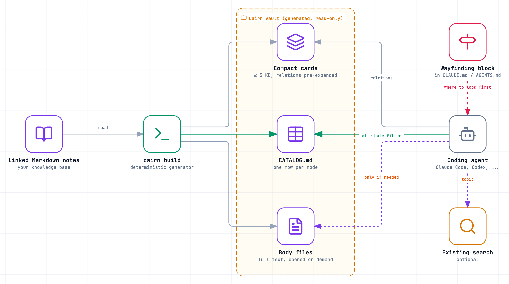
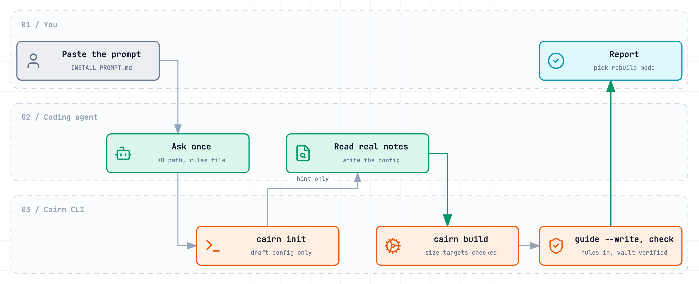
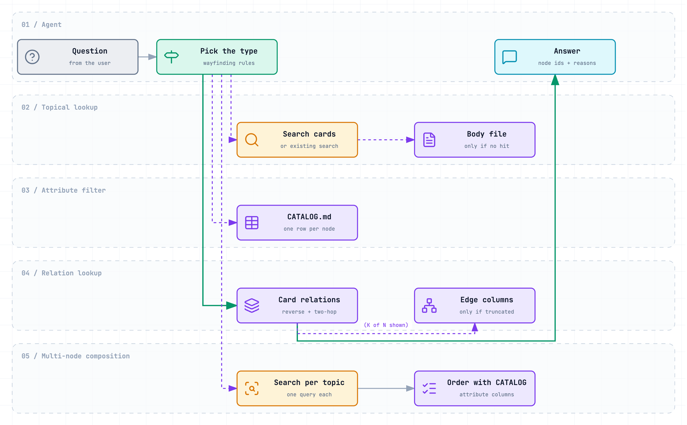

# Cairn

[](https://github.com/Woka-inc/cairn/actions/workflows/test.yml)


[](LICENSE)

English · [한국어](README.ko.md)

**Compact cards and wayfinding for lower-cost agentic search over linked Markdown knowledge bases.**

<p align="center">
  <picture>
    <source media="(prefers-color-scheme: dark)" srcset="docs/assets/architecture-dark.png">
    
  </picture>
</p>

Author and maintainer: Chioh Song (Woka CEO) · Paper: *Cairn: Compact Cards and Wayfinding for Lower-Cost Agentic Search over Linked Knowledge Bases* (arXiv identifier to be added)

## Contents

- [What is Cairn?](#what-is-cairn)
- [What is in this repository?](#what-is-in-this-repository)
- [Results](#results)
- [Quick start: install with one prompt](#quick-start-install-with-one-prompt)
- [How an agent uses Cairn](#how-an-agent-uses-cairn)
- [Measuring on your own knowledge base](#measuring-on-your-own-knowledge-base)
- [FAQ](#faq)
- [Limitations](#limitations)
- [Citation](#citation)
- [License and acknowledgments](#license-and-acknowledgments)

## What is Cairn?

A coding agent such as Claude Code or Codex that searches a folder of linked notes pays for every model request: each request re-reads the system prompt and every earlier tool result. The cost therefore grows with **how many requests** the agent makes and **how much** it reads. Two things make this expensive:

1. **Whole notes are large.** The agent opens a 40 KB note to learn three facts it needed to choose the note.
2. **Links point one way.** A note lists what it depends on, not what depends on it. Questions such as "what uses X?" or "what else cites the same source?" make the agent open note after note.

Cairn moves that work from query time to indexing time. One deterministic pass over your notes writes three things the agent reads instead:

| Piece | What it is | Answers |
|---|---|---|
| **Compact cards** | One small card per note (5 KB target) with only what is needed to choose it, plus a Relations section that already lists reverse edges and two-hop neighbors | "What does X depend on, and what depends on X?" |
| **Attribute table** | `CATALOG.md`, one row per note with its attributes and edges | "Which notes are stable, owned by team A, in Python?" |
| **Wayfinding rules** | One short rule per question type, inserted into `CLAUDE.md` or `AGENTS.md` | "Where do I look first?" |

The full text stays available as body files and is opened only when a card is not enough. Generation uses no LLM, no embeddings, and no dependencies beyond Node.js 22, and the same notes always give byte-identical output.

## What is in this repository?

| Path | What it is |
|---|---|
| [`bin/cairn.mjs`](bin/cairn.mjs), [`src/`](src/) | The generator and CLI: `init`, `build`, `guide`, `check`, `watch` |
| [`INSTALL_PROMPT.md`](INSTALL_PROMPT.md) | A prompt you paste into a coding agent; it sets Cairn up on your knowledge base |
| [`examples/quillstone/`](examples/quillstone/) | A synthetic knowledge base (35 notes about a fictional data-pipeline library), its config, the generated vault, and an `AGENTS.md` with the wayfinding block |
| [`docs/configuration.md`](docs/configuration.md) | Commands, every config key, where the config and vault go, and how to keep the vault fresh |
| [`docs/measure.md`](docs/measure.md), [`scripts/measure.mjs`](scripts/measure.mjs) | How to compare Cairn with your current setup, and a paired-bootstrap analysis script |
| [`hooks/post-merge.sample`](hooks/post-merge.sample) | A git hook that rebuilds the vault when the notes change |
| [`test/`](test/) | `node --test` suite (determinism, size caps, reverse and two-hop edges, truncation markers, config errors) |

## Results

The paper measured one production knowledge base: 64 education modules in Korean, 30 fixed questions across four question types, one run per question, Claude Code with claude-sonnet-5-5. All four configurations used the same model, harness, and questions.

| Configuration | Recall@5 | MRR | API requests | Mean tokens | Mean list-price cost |
|---|---|---|---|---|---|
| Vault only (full notes) | 1.00 | 1.00 | 3.43 | 37,664 | $0.0526 |
| Server search only | 0.90 | 0.95 | 3.30 | 30,364 | $0.0421 |
| Vault + server search (pilot) | 1.00 | 1.00 | 3.03 | 33,245 | $0.0427 |
| **Cairn** | **1.00** | **1.00** | **2.40** | **21,597** | **$0.0248** |

- Against the pilot, Cairn used **35.0%** fewer mean tokens (95% CI [−46.1%, −21.2%]) and cost **41.9%** less, with retrieval at the ceiling for both. A median card was 3.3 KB against 44.7 KB for a pilot note.
- In a 2×2 ablation, compact cards alone cut tokens by 21.3%; wayfinding alone did not help significantly (−6.8%); both together cut 37.0%.
- A later re-measurement against a same-day baseline found a **17.7%** reduction (95% CI [−31.0%, −3.3%]). The baseline itself moved by 13.6% between runs, so the **direction** of the effect is established and its **size is not**.

Read these numbers as one data point: one domain, one language, questions that were also used during design. [Measure on your own knowledge base](#measuring-on-your-own-knowledge-base) before you rely on them.

## Quick start: install with one prompt

<p align="center">
  <picture>
    <source media="(prefers-color-scheme: dark)" srcset="docs/assets/install-dark.png">
    
  </picture>
</p>

Open your coding agent in the project that holds your notes and paste the contents of [`INSTALL_PROMPT.md`](INSTALL_PROMPT.md). The agent asks for the knowledge-base path once, inspects real notes before writing any field name, builds the vault, inserts the rules between markers in your instruction file, and runs `cairn check`. It does not modify your notes, and it commits nothing unless you ask.

Prefer to do it by hand? Node.js 22 or later is the only requirement:

```sh
git clone https://github.com/Woka-inc/cairn
node cairn/bin/cairn.mjs init notes --config cairn.config.json --write   # draft a config; review it
node cairn/bin/cairn.mjs build                                           # write the vault
node cairn/bin/cairn.mjs guide --write AGENTS.md                          # or CLAUDE.md
node cairn/bin/cairn.mjs check                                           # verify
```

`init` is a draft: open a few real notes and confirm each field before you build. Every key is explained in [`docs/configuration.md`](docs/configuration.md).

To try it without your own notes:

```sh
git clone https://github.com/Woka-inc/cairn && cd cairn
npm run build-example && npm run check-example && npm test
```

## How an agent uses Cairn

<p align="center">
  <picture>
    <source media="(prefers-color-scheme: dark)" srcset="docs/assets/wayfinding-dark.png">
    
  </picture>
</p>

The rules are plain text in your instruction file, so any agent that reads `CLAUDE.md` or `AGENTS.md` can follow them; there is no classifier or server. The relation question is where the cards pay off. A card from the example lists what points back to the note and which notes share a design document with it, and says explicitly when a list was cut short:

```
- Used by (reverse of Depends on): qs-cli (Command-line runner); qs-config (Configuration loader); qs-dedupe (Deduplication); qs-io-base (I/O adapter base); qs-logging (Structured logging); qs-metrics (Metrics exporter) (6 of 16 shown — capped at k=6)
- Related from (reverse of Related): none
- Shares design docs with (two hops via Design docs): qs-dedupe (Deduplication) ×1; qs-tx-filter (Filtering) ×1; qs-tx-join (Joins) ×1; qs-tx-map (Row mapping) ×1; qs-tx-window (Windowed aggregation) ×1 (5 of 14 shown — 1 hub skipped: design_docs targets used by ≥7 nodes)
```

`none` therefore means that no such neighbor exists, and the agent stops instead of searching further. The generated rules for the example are in [`examples/quillstone/AGENTS.md`](examples/quillstone/AGENTS.md).

## Measuring on your own knowledge base

Savings depend on your notes, your question mix, and your harness. [`docs/measure.md`](docs/measure.md) describes a fair comparison:

1. Fix a question set in advance that covers all four question types (hold some out from tuning if you can).
2. Run your current setup and Cairn with the same model, tools, and turn limit, in the same period, several times per question.
3. Record tokens, cost, and requests per run as JSONL.
4. Run `node scripts/measure.mjs runs.jsonl --baseline baseline --treatment cairn --by type` for the change with a paired bootstrap confidence interval.

## FAQ

**Does Cairn replace RAG or a vector database?** No. It targets agents that browse linked documents with file and search tools. If you already have a search command, Cairn's rules route topical questions to it and use the cards for relations and attribute filters.

**Does it change my notes?** No. It reads them and writes a separate vault folder. The only existing file it edits is your instruction file, and only between the `cairn:wayfinding` markers.

**What do my notes need?** Markdown files with YAML front matter: an id (or the file name), and ideally a title, a few categorical attributes, and fields that link to other notes (`depends_on`, `related`, `cites`, ...). Obsidian vaults, wikis, and documentation folders all fit.

**How big a knowledge base?** The paper's case had 64 notes; the example has 35. The attribute table grows linearly with the number of notes, about 232 KB at 1,000 notes by the paper's extrapolation, so very large collections need the table split or its target raised knowingly.

**Is the vault safe to commit?** It holds the same text as your notes, so treat it with the same visibility. Ignoring it in git is the safe default; see [`docs/configuration.md`](docs/configuration.md#keeping-the-vault-fresh).

**Which agents work?** Any agent that reads an instruction file and has file-reading and search tools. The paper measured Claude Code.

## Limitations

- **One measured setting.** A single Korean knowledge base, 30 questions that overlapped with design, one run per question. Effect sizes ranged from 17.7% to 37.0% across three measurements. Other domains, languages, and question sets were not measured.
- **Pre-expanded neighborhoods are untested as a cause.** Savings on relation questions came mostly from reading a small card instead of a large note; only one of the 30 questions needed a two-hop neighbor.
- **Wayfinding alone did not help significantly**; it helped together with compact cards.
- **Topical-heavy workloads may cost more** than a search-only setup. In the paper's setting Cairn lost its advantage once topical lookups exceeded about 70% of questions in raw tokens, or about 95% in list-price cost.
- **Measured with this code only on the paper's testbed.** There, this code with a testbed-specific configuration and templates now builds the production vault, byte for byte identical to the output of the in-house generator used in the paper's re-measurement. The default templates in this repository lay files out differently and have not been measured.
- **Front matter** is read with a parser for the YAML subset that notes use (mappings, lists, flow collections, quoted and block scalars); anchors, aliases, and tags are rejected with a line number.

## Citation

```bibtex
@misc{song2026cairn,
  author        = {Chioh Song},
  title         = {Cairn: Compact Cards and Wayfinding for Lower-Cost Agentic Search over Linked Knowledge Bases},
  year          = {2026},
  eprint        = {XXXX.XXXXX},
  archivePrefix = {arXiv}
}
```

See also [`CITATION.cff`](CITATION.cff).

## License and acknowledgments

- Code (`bin/`, `src/`, `scripts/`, `test/`, `hooks/`): [MIT](LICENSE).
- Documentation, diagrams, the example knowledge base, and the paper text: [CC BY 4.0](LICENSE-docs).
- Diagrams are generated from [`docs/diagrams/`](docs/diagrams/) with [Archify](https://github.com/tt-a1i/archify).

The design, implementation, measurement, analysis, and writing of Cairn, including this repository, were carried out by Anthropic's Claude under the author's direction. The author is responsible for the content. Questions and bug reports: [GitHub issues](https://github.com/Woka-inc/cairn/issues).
